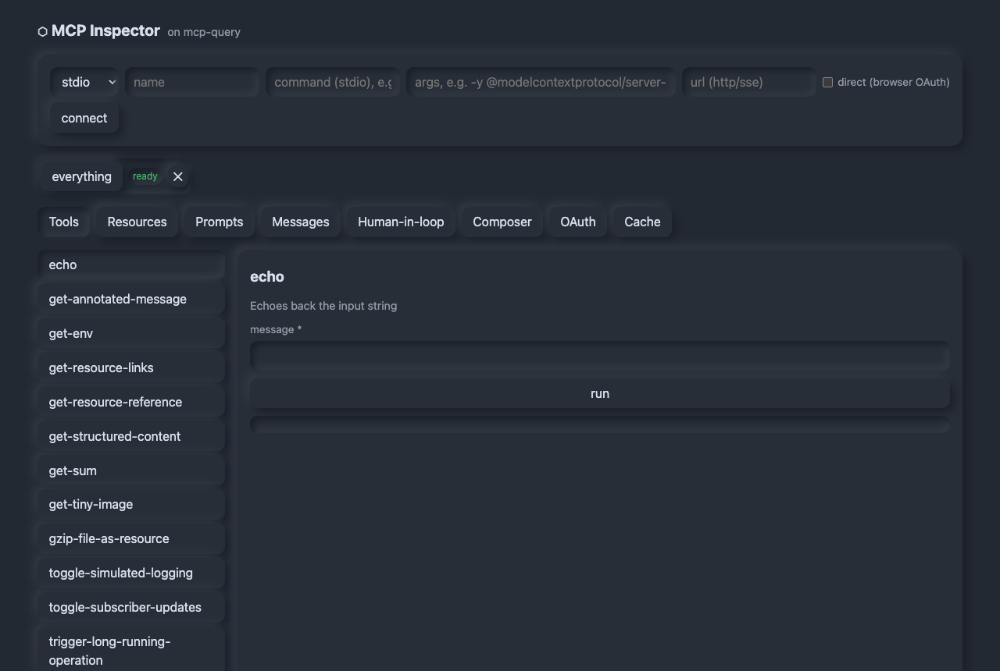
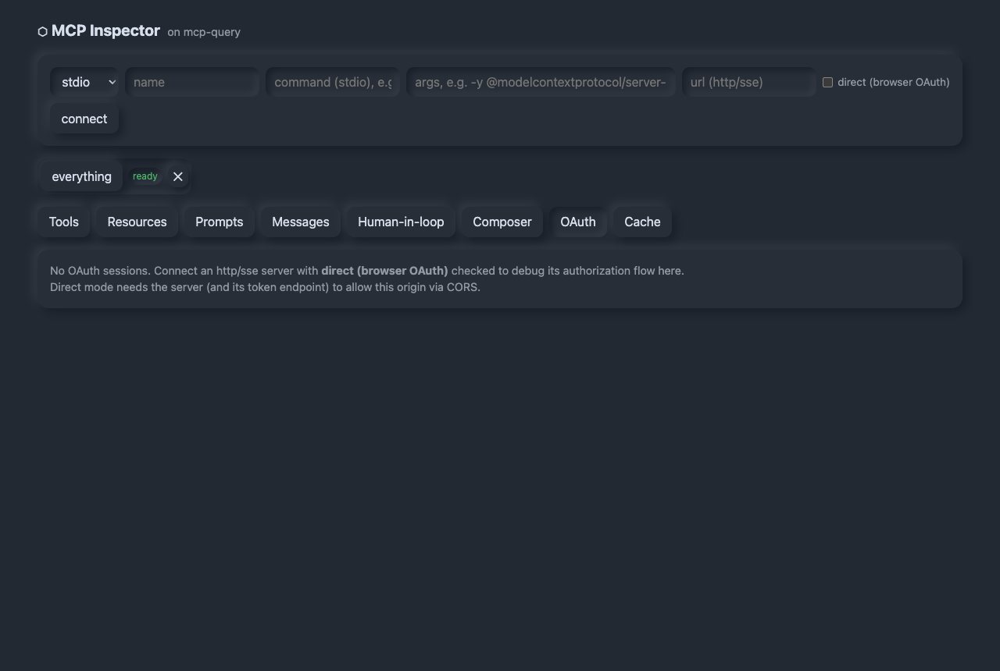
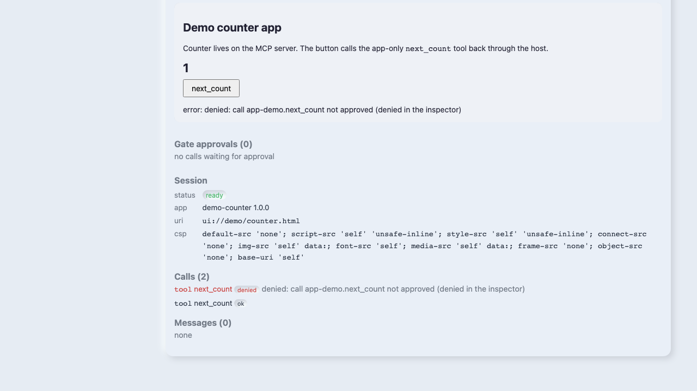
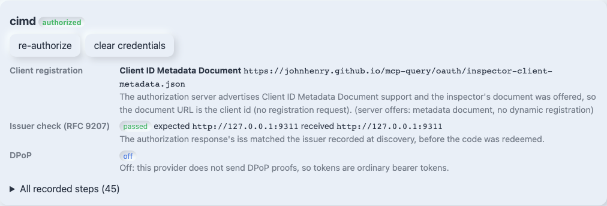
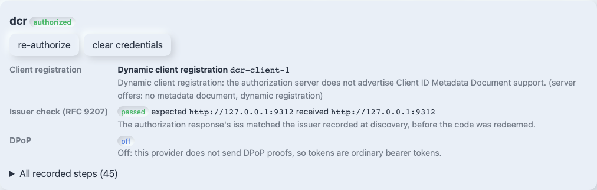
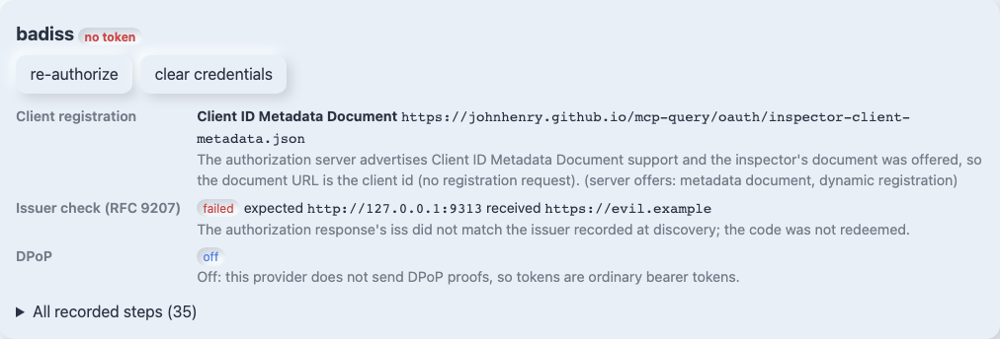

# MCP Inspector (built on mcp-query)

A flagship MCP Inspector — Web Components + Vite, no framework — that **dogfoods
mcp-query's framework-agnostic core** (binding custom elements to `cache.subscribe`,
`subscribeServerState`, `broker.subscribe`, and `DevtoolsHub` via a tiny `Reactive` base,
the Web Components analog of `useSyncExternalStore`). Built per
[modern-web-guidance](https://github.com/GoogleChrome/modern-web-guidance), simple neumorphic.

## Screenshots

**Tools** — schema-driven forms with destructive-confirm; results render inline.



**Messages** — the raw JSON-RPC log: live request/response/notification stream with filtering, NDJSON export, and per-request replay (⟳).


**OAuth** — the browser-side OAuth debugger for http/sse servers: a plain-language summary (which client-registration path was used and why, the issuer check, DPoP on/off) above a step-through timeline, with re-authorize / clear credentials. See [OAuth](#oauth) below.



**Apps** — MCP Apps (SEP-1865): tools carrying `_meta.ui.resourceUri` open in a sandboxed iframe (proxy page on another origin) with the session's `status`, `calls`, and `messages` live beside it.


## Run

```bash
npm install            # from the monorepo root
npm run dev -w @mcp-query/inspector
# the proxy prints:  → Open: http://localhost:5173/?proxyToken=…
```

Open the printed URL (the `proxyToken` authorizes the browser↔proxy WebSocket). Then add a
server — e.g. stdio `npx` `-y @modelcontextprotocol/server-everything`, or an HTTP/SSE URL.

### The proxy and `PROXY_ALLOW_ANY` (read this)

The proxy is [`apps/shared/src/proxy-cli.ts`](../shared/src/proxy-cli.ts), the same hardened bridge the
other apps use. It binds `127.0.0.1` only, requires the per-run token, requires an `Origin` header,
and accepts only loopback origins (`localhost`, `127.0.0.1`, `[::1]`). **It spawns nothing unless the
target matches an allowlist.**

The inspector is a debugger: you type an arbitrary server command (`npx -y …`, `node ./my-server.js`)
and it is spawned on your machine. So `npm run dev` (script `dev:proxy`) sets **`PROXY_ALLOW_ANY=1`**,
the named opt-in that lets any holder of the token run **any local command**, and the proxy prints a
warning at startup. What that means in practice: anything that gets the token (it is in the printed URL,
so do not paste that URL into shared terminals, CI logs or screenshots) can execute code as you. The
opt-in is set in the inspector's dev script only; nothing else turns it on.

To run restricted to an allowlist instead:

```bash
npm run dev:restricted -w @mcp-query/inspector   # same as dev, without PROXY_ALLOW_ANY
```

Only targets matching [`proxy-allow.json`](proxy-allow.json) can then be connected. It ships with one
entry, the bundled demo server (`npx tsx fixtures/mcp-app-demo.ts`, used by **+ demo MCP App server**),
so that button works with or without the opt-in. Add your own rules to that file (exact `command`, exact
`args` with optional `{ "endsWith": … }` / `{ "any": true }` items, `allowEnv` to permit `env`; http/sse
rules match `url` exactly), or point `PROXY_ALLOW_FILE` at another file. Rule format and protocol:
[`ws-stdio-bridge.md`](../../packages/mcp-query/docs/ws-stdio-bridge.md). The MCP Apps sandbox proxy
(`sandbox/`, below) is a separate, unchanged component.

### MCP Apps (the Apps tab)

The client is built with `extensions: mcpAppsExtensions()`, so servers see `io.modelcontextprotocol/ui`.
The **Apps** tab lists the active server's tools that declare `_meta.ui.resourceUri` (app-only tools are
flagged), opens one with the framework-agnostic `createAppHost(...).open(...)` + `mountIframe(...)` from
[`@johnhenry/mcp-query-ui`](../../packages/mcp-query-ui), and renders `session.subscribe` state beside the
app: status (`loaded → connecting → ready → closed`), app info, the exact CSP the proxy must enforce, every
app-initiated call with its outcome, and `ui/message`s. App `tools/call`/`resources/read` run through the
same `MCPClient` as the Tools tab, so they show up in the Messages log too. `ui/open-link` is refused
(the host default). Switching tabs closes the open app.

The spec requires the app to be wrapped in a **sandbox proxy served from a different origin** than the host.
`npm run dev` therefore starts a third process, `sandbox/server.ts`, serving `sandbox/proxy.html`
on `http://127.0.0.1:5174` while the inspector is on `http://localhost:5173` (different host and port;
`mountIframe` throws if they match). The proxy (`sandbox/proxy-lib.js`) waits for the host's
`sandbox-resource-ready`, builds the inner iframe (`sandbox="allow-scripts"`, never `allow-same-origin`),
applies the metadata-derived CSP as a `<meta>` tag, and relays all other JSON-RPC unchanged; it pins its
postMessage target to the inspector origin passed as `?host=`. It is a local copy: the
`@modelcontextprotocol/ext-apps` npm package ships the host/app libraries but not a sandbox page.

**Try it offline:** with `npm run dev` running, click **+ demo MCP App server** (it spawns
`fixtures/mcp-app-demo.ts` over stdio through the proxy, i.e. `npx tsx fixtures/mcp-app-demo.ts` relative to
`apps/inspector`), open the **Apps** tab, pick `show_counter`, **open app**, and press the app's button; each
press is an app-initiated `next_count` call listed under *Calls*. Override ports with `SANDBOX_PORT` (server)
and `?sandboxPort=` (inspector URL) if 5174 is taken.

### Governed mode (approvals beside the app)

By default the app's `tools/call` goes straight through the inspector's client. Tick **governed (approvals)**
before **open app**: the **approve patterns** box holds `server.tool` globs (default `*`) and that app's
tool call matching one waits as an **approval** card next to the app, showing who asked
(`mcp-app:<ui uri>`), the tool and its arguments, with **Approve** / **Deny**. The app's call resolves (or fails with
a "denied" error) accordingly; closing the app denies what it still has waiting. Loading the app (a resource read)
and unmatched calls are never held. Off by default; nothing else about the inspector changes.



Notes: governed mode uses the inspector's **single connection**, so a stdio server is spawned once and the app, the
Tools tab and the Messages log all talk to the same process (the demo counter is shared). The inspector's client is
built with one request interceptor (`src/lib/governed.ts`): the same `authorize()` + approval-broker pair
[`@johnhenry/mcp-gate`](../../packages/mcp-gate)'s `createGateClient` installs, but it only acts on app-initiated
calls (principal `mcp-app:<uri>`, set by the app host) of an app opened with the box ticked; every other operation
passes through untouched. Approval text (tool name, arguments, principal) comes from the app and is rendered as
text. Policy is just the approve patterns (no redaction, rate limit or audit sink here). Still local-only: the
sandbox proxy stays a local second origin; there is no hosted sandbox.

### Server Cards (the Card tab)

The **Card** tab fetches the [Server Card](https://modelcontextprotocol.io/seps/2127-mcp-server-cards) (SEP-2127) for
the active HTTP server (`<url>/server-card`; or paste any card URL) and shows its identity, remotes and protocol
versions next to the live connection, listing every disagreement (name, version, connected URL, negotiated and
supported protocol versions; the live server wins). The fetch runs in the browser, so the card host must send CORS
headers. Card text is untrusted: it is rendered as text only, icons are listed but never loaded, and nothing in the card
is clickable.

## Architecture

```
Browser (Vite SPA, Web Components)                 Node proxy (apps/shared proxy-cli)
  mcp-query MCPClient                                bearer token · loopback bind · Origin check · target allowlist
   └─ WebSocketProxyTransport  ── ws ──▶  relays JSON-RPC frames ──▶  stdio / Streamable HTTP / SSE
```

The **proxy** is the one piece mcp-query deliberately leaves out (a browser can't spawn
stdio processes). It bridges the browser to stdio/HTTP/SSE MCP servers and is the only
trusted local component.

- `../shared/src/proxy.ts` + `proxy-cli.ts` — the WebSocket↔transport bridge (shared with the other apps); `proxy-allow.json` — this app's allowlist.
- `src/lib/transport.ts` — `WebSocketProxyTransport` (SDK `Transport` over the proxy).
- `src/lib/reactive.ts` — the `Reactive` base element + store-tracking.
- `src/lib/store.ts` — the single `MCPClient`, `InteractionBroker`, `DevtoolsHub`, active-server signal.
- `src/components/*` — `<mcp-connections>`, `<mcp-tools>`, `<mcp-apps>`, `<mcp-resources>`, `<mcp-prompts>`, `<mcp-app>`.
- `sandbox/` — the MCP Apps sandbox proxy page + its static server; `fixtures/mcp-app-demo.ts` — demo app server.

## Status (phased)

- **Phase 1 (now):** monorepo + proxy + reactive Web Components; multi-server connect; tools
  (schema-driven forms + destructive confirm), resources (live subscribe), prompts (get).
- **Phase 2 (done):** raw JSON-RPC message log — filter, expand, NDJSON export, replay,
  IndexedDB persistence. (Web Worker indexing: future.)
- **Phase 3 (done):** human-in-the-loop center (manual sampling, elicitation forms, roots
  editor + `roots/list_changed`, audit), raw request composer, cache inspector.
- **OAuth debugger (done):** check **direct (browser OAuth)** when connecting an http/sse
  server and the OAuth flow runs *in the browser* (where redirects belong), with every step
  recorded by `instrumentAuthProvider` and shown as a step-through timeline (tokens redacted),
  plus re-authorize / clear-credentials. PKCE via a sessionStorage-backed
  `BrowserOAuthProvider`; the `?code=` redirect is resumed on load. (Direct mode needs the
  server + token endpoint to allow this origin via CORS.)
- **Phase 4 (done):** PWA (web app manifest + app-shell service worker, registered in prod),
  a11y pass (semantic HTML, roles, `aria-live`, skip link, focus-visible, reduced-motion),
  CSP-friendly markup, and app tests (`npm test` — schema-form, reactive base, proxy defaults).

### OAuth

Check **direct (browser OAuth)** when connecting an http/sse server and the flow runs in the
browser through `BrowserOAuthProvider` (`src/lib/oauth.ts`), recorded by `instrumentAuthProvider`.

- **Client registration: Client ID Metadata Document first, dynamic registration as the fallback.**
  The provider hands the SDK a `clientMetadataUrl`; the SDK uses it only when the authorization
  server advertises `client_id_metadata_document_supported`, otherwise it registers dynamically.
  Before connecting, the provider also fetches the document and refuses to offer it when it is
  unreachable, not JSON, its `client_id` is not its own URL, or it does not list this page's redirect
  URI. The summary says which path was taken and why (e.g. "the authorization server does not
  advertise Client ID Metadata Document support", "document not reachable (HTTP 404)").
- **The inspector's own document** is [`oauth/inspector-client-metadata.json`](../../oauth/inspector-client-metadata.json)
  at the repo root, next to the CLI's (the CLI's lists loopback port 8976; this one lists the dev
  server's origin, `http://localhost:5173/` and `http://127.0.0.1:5173/`, because the redirect URI is
  the page's own URL). It is a public client (`token_endpoint_auth_method: none`, PKCE, no secret; the
  draft forbids shared-secret methods and `client_secret` in these documents) with `http` loopback
  redirect URIs and `application_type: native`. The draft itself puts no limit on `redirect_uris`, but
  lets an authorization server restrict them (for example to the document's own origin), so a strict
  server may refuse these localhost redirects for a `github.io` client; that cannot be detected ahead of
  time and is not yet tried against any real server. Its URL
  is `INSPECTOR_CLIENT_METADATA_URL` in `src/lib/oauth.ts`; override it at build time with
  `VITE_INSPECTOR_CLIENT_METADATA_URL=<https url | off>`. Serve the app on a different origin or port and
  the redirect URI is not in the document, so the inspector falls back to dynamic registration (or point
  the constant at a document of your own that lists your origin).
- **The document is not live until this change is merged and GitHub Pages rebuilds.** It is served by
  Pages at `https://johnhenry.github.io/mcp-query/oauth/inspector-client-metadata.json`; until then that
  URL returns 404, the pre-flight check fails, and the inspector registers dynamically (the stepper shows
  "document not reachable (HTTP 404)"). Authorization servers that support the draft also fetch the
  document themselves, so they need that URL to resolve.
- **Issuer check (RFC 9207).** The provider keeps `discoveryState` across the redirect, so the SDK
  compares the callback's `iss` with the issuer recorded at discovery before redeeming the code. The
  summary shows pass or fail with the expected and received issuer; a failed check never redeems the
  code. (On the SDK 2.0.0 floor, which does not validate `iss`, the callback leg passes the code alone and
  the stepper records that the check did not run.) Credentials are stored per issuer.
- **DPoP** is shown as on (with the key thumbprint, never the key) when a provider records it; the
  browser provider does not enable DPoP, so it shows off.
- Anything secret (tokens, PKCE verifier, client secrets) is masked in the timeline as before. The step
  log is kept in `sessionStorage` so it survives the redirect to the authorization server.





The screenshots were taken in headless Chromium against local mock authorization servers (the
document request was intercepted, since the real URL is not live yet); no real authorization server
was involved.

### Production CSP

Serve the built app with a strict policy (the dev server needs Vite's inline HMR, so it's
not set as a `<meta>`):

```
default-src 'self'; script-src 'self'; style-src 'self' 'unsafe-inline';
img-src 'self' data:; connect-src 'self' ws://localhost:* http: https:;
worker-src 'self'; frame-ancestors 'none'
```

(`connect-src` must allow the proxy WebSocket and any HTTP/SSE MCP servers you inspect. To use the
Apps tab, also add `frame-src <your sandbox proxy origin>`; `default-src 'self'` would otherwise block it.)
